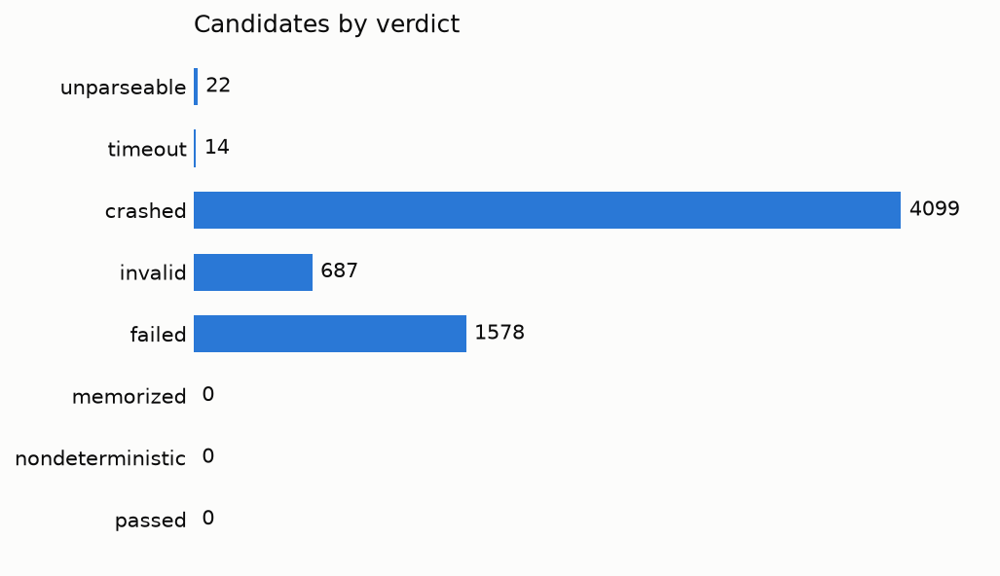
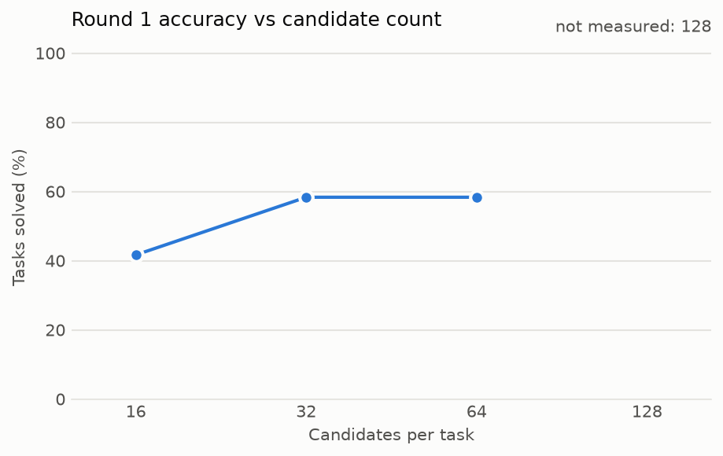

# vora-arc

vora-arc solves ARC-AGI tasks by having a language model write candidate
`transform(grid)` programs and running each one in a
[Vora](https://github.com/vorash/vora) sandbox. Vora runs the code and reports
raw results. This package decides which programs are correct.

## Results

Mistral 7B solved none of the first 100 ARC-AGI-1 evaluation tasks at 64 samples per task. The same pipeline
solved 7 of 12 hand-picked simple tasks, so the zero comes from the model and its plain prompt. Generation set
the run's length. Sandbox time would be 13% of it even if no two sandboxes overlapped. [The results document](docs/experiments-2-3-results.md)
has the method, the limits and what wasn't measured.

| Tasks | Samples per task | Solved | Programs that passed train pairs | GPU time, cost |
|---|---|---:|---:|---:|
| ARC-AGI-1 evaluation, first 100 by id | 64 | 0 / 100 | 0 | 3.65 h, 2.87 EUR |
| ARC-AGI-1 evaluation, first 20 by id, with refinement | 64 cached + 32 new | 0 / 20 | 0 | 0.64 h, 0.50 EUR |
| ARC-AGI-2 evaluation, first 20 by id | 64 | 0 / 20 | 0 | 1.12 h, 0.88 EUR |
| ARC-AGI-1 training, first 20 by id | 64 | 0 / 20 | 0 | 0.55 h, 0.43 EUR |
| ARC-AGI-1 training, 12 hand-picked simple tasks (control, not an accuracy estimate) | 64 | 7 / 12 | 25 | 0.11 h, 0.08 EUR |

Each row is one run on one rented NVIDIA L4, chosen for its cost. The numbers don't describe other models,
prompts or hardware.





[Experiment 1](docs/experiment-1-results.md) measures the sandbox side: a warm pool's throughput against a new
sandbox per program, and whether anything leaks between runs.

## Architecture

```
vLLM (GPU) --completions--> vora-arc --programs--> Vora sandboxes (pool)
                               |  <--raw grids---
                               v
                           PostgreSQL --> vora-arc report --> Markdown, charts
```

`vora-arc solve` asks the model for candidate programs and caches each completion. It runs every distinct
program in a sandbox, judges the raw results against the train pairs, and votes with the programs that passed.
Vora knows nothing about ARC. It runs code and reports what happened.
[The pipeline document](docs/model-pipeline.md) explains each step, and [the pool document](docs/pools.md) covers
warm pools.

## Reproduce the results

The stored runs reproduce the reports with no GPU or sandbox. You need PostgreSQL 16 or later.

```sh
createdb vora_arc
pg_restore --no-owner -d vora_arc results/l4-2026-11-06/vora_arc.dump
export VORA_ARC_DATABASE_URL=postgresql:///vora_arc GPU_EUR_PER_HOUR=0.7875

RUN=20261106T142133Z-bcc15e
uv run vora-arc report --run $RUN --out /tmp/reports
diff /tmp/reports/$RUN/report.md results/l4-2026-11-06/$RUN/report.md
```

To run the experiments again, you need a GPU, a vLLM v0.32.0 server, a Vora API and an empty database. Sampling isn't seeded,
so a new run writes different programs and its numbers can differ. A restored database would answer from its
cached completions.

```sh
scripts/download_data.sh

# Start vLLM with: mistralai/Mistral-7B-Instruct-v0.3 --max-model-len 32768 --gpu-memory-utilization 0.9
export VLLM_URL=http://gpu-host:8000/v1 VLLM_MODEL=mistralai/Mistral-7B-Instruct-v0.3
export VORA_API_URL=… VORA_API_KEY=…
export VORA_ARC_DATABASE_URL=<an empty PostgreSQL database for this solver>
export VORA_ARC_PROFILE=profiles/python-arc.toml

SOLVE="uv run vora-arc solve --samples 64 --pool --tasks-at-once 8"
$SOLVE --dataset arc1 --split evaluation --limit 100
$SOLVE --dataset arc2 --split evaluation --limit 20
$SOLVE --dataset arc1 --split evaluation --limit 20 --refine
$SOLVE --dataset arc1 --split training --limit 20

GPU_EUR_PER_HOUR=<price> uv run vora-arc report --run <run id printed by solve>
```

To run the control, copy the 12 tasks that [the results document](docs/experiments-2-3-results.md) lists into
`<dir>/arc1/training/`, and add `--dataset arc1 --split training --data-dir <dir>`.

`VORA_MAX_CONCURRENCY` caps the sandboxes running at once (default 8). A report goes to `results/<run id>/`
unless `--out` names another parent directory. The server here was a Scaleway L4-1-24G, set up with
[inference-lab](https://github.com/iuliansafta/inference-lab), a separate Terraform and Ansible repository.

## Test it

```sh
uv run pytest           # needs no model, GPU or sandbox
uv run mypy src tests
```

PostgreSQL tests start a throwaway cluster from `initdb` on PATH, or else from the
binaries in the dev dependency `pixeltable-pgserver`. They skip if neither exists.
Tests marked `sandbox` need `VORA_API_URL` and `VORA_API_KEY`.

`dashboards/vora-arc.json` is a Grafana dashboard of Vora's Prometheus metrics.
