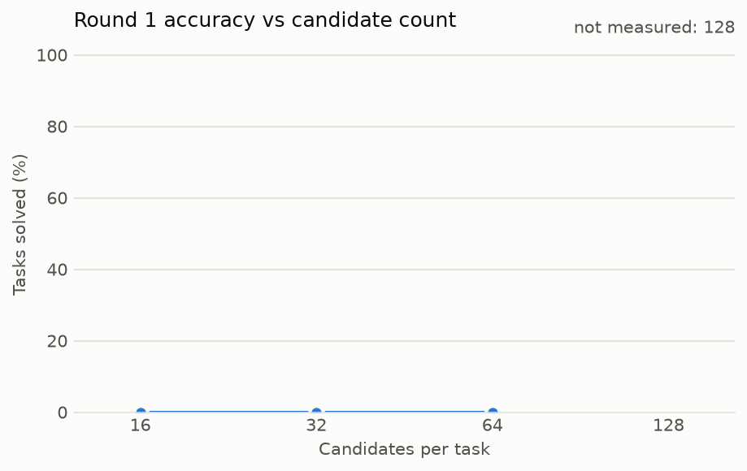
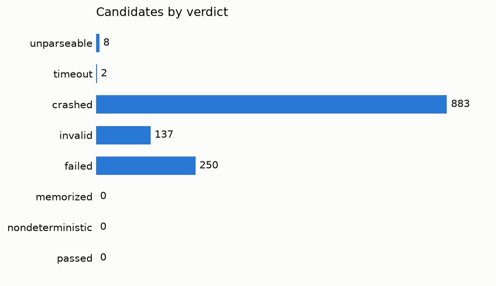

# Run 20261106T180456Z-69613b

- Dataset: arc2 evaluation, 20 tasks (limit 20)
- Model: mistralai/Mistral-7B-Instruct-v0.3; 64 samples per task; refinement off
- Sandbox: profile python-arc, backend gvisor, at most 8 at a time; 8 task(s) at once
- Status: finished
- Total wall-clock: 4035.071 s

## Accuracy

| | Solved |
|---|---|
| Overall, 2 attempts | 0 / 20 (0.0%) |
| Round 1, of all tasks | 0 / 20 (0.0%) |
| Round 2, of the tasks it refined | not measured (run without --refine) |

11 tasks have several test inputs. Each counts as solved only if one answer gets all of them right.

## Accuracy vs candidate count

Round 1, re-voted on the first k samples of each task in this run. Refinement isn't included. A count above this run's 64 samples is not measured.

| Candidates per task | Solved |
|---|---|
| 16 | 0 / 20 (0.0%) |
| 32 | 0 / 20 (0.0%) |
| 64 | 0 / 20 (0.0%) |
| 128 | not measured |

## Verdicts

1280 candidates, 1272 distinct programs, 1272 sandbox runs. A duplicate counts under its first copy's verdict.

| Verdict | Candidates |
|---|---|
| unparseable | 8 |
| timeout | 2 |
| crashed | 883 |
| invalid | 137 |
| failed | 250 |
| memorized | 0 |
| nondeterministic | 0 |
| passed | 0 |

## Time split

| Phase | Time | Basis |
|---|---|---|
| generation | 9920.240 s | sum over tasks that overlap, so it can exceed the run's wall-clock |
| scheduling | 1197.557 s | sum over jobs of the wait for a slot |
| startup | 23.250 s | sum over sandbox runs, seen from the client |
| execution | 276.067 s | sum over sandbox runs, seen from the client |
| verification | 24.528 ms | sum over jobs of verdict and vote computation |
| reset | 53.454 s (1272 of 1272 runs used a pool's running sandbox and the rest a fresh one; 1272 of 1272 reported a reset of their own) | sum over sandbox runs |

Sums over jobs overlap when jobs run at once, so they don't add up to the wall-clock.

## Policy events

- Denied syscalls: not measured. Vora's seccomp filter refuses calls without counting them, so no number exists.
- Blocked network attempts: not measured. This solver doesn't read them. Vora's `egress_denied` exists only in restricted mode, where it is a floor, and pools refuse that mode.

## Cost

- Wall-clock, what a rented GPU costs for this run: 1.120853 GPU-hours, 0.882672 EUR
- Time with a model request open, the lower bound: not measured
- Cost per task: 0.044134 EUR on wall-clock, not measured as the lower bound
- Price: 0.7875 EUR per hour
- Note: the lower bound is not measured: tasks overlapped, so their request times can't be added
