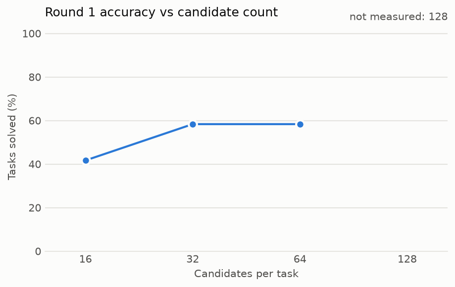
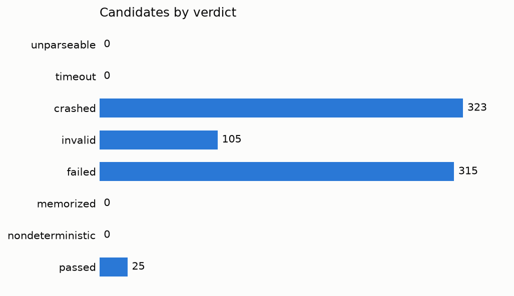

# Run 20261106T195116Z-adb599

- Dataset: arc1 training, 12 tasks
- Model: mistralai/Mistral-7B-Instruct-v0.3; 64 samples per task; refinement off
- Sandbox: profile python-arc, backend gvisor, at most 8 at a time; 8 task(s) at once
- Status: finished
- Total wall-clock: 383.526 s

## Accuracy

| | Solved |
|---|---|
| Overall, 2 attempts | 7 / 12 (58.3%) |
| Round 1, of all tasks | 7 / 12 (58.3%) |
| Round 2, of the tasks it refined | not measured (run without --refine) |

1 tasks have several test inputs. Each counts as solved only if one answer gets all of them right.

## Accuracy vs candidate count

Round 1, re-voted on the first k samples of each task in this run. Refinement isn't included. A count above this run's 64 samples is not measured.

| Candidates per task | Solved |
|---|---|
| 16 | 5 / 12 (41.7%) |
| 32 | 7 / 12 (58.3%) |
| 64 | 7 / 12 (58.3%) |
| 128 | not measured |

## Verdicts

768 candidates, 737 distinct programs, 760 sandbox runs. A duplicate counts under its first copy's verdict.

| Verdict | Candidates |
|---|---|
| unparseable | 0 |
| timeout | 0 |
| crashed | 323 |
| invalid | 105 |
| failed | 315 |
| memorized | 0 |
| nondeterministic | 0 |
| passed | 25 |

## Time split

| Phase | Time | Basis |
|---|---|---|
| generation | 929.050 s | sum over tasks that overlap, so it can exceed the run's wall-clock |
| scheduling | 656.281 s | sum over jobs of the wait for a slot |
| startup | 13.057 s | sum over sandbox runs, seen from the client |
| execution | 149.212 s | sum over sandbox runs, seen from the client |
| verification | 13.562 ms | sum over jobs of verdict and vote computation |
| reset | 31.758 s (760 of 760 runs used a pool's running sandbox and the rest a fresh one; 760 of 760 reported a reset of their own) | sum over sandbox runs |

Sums over jobs overlap when jobs run at once, so they don't add up to the wall-clock.

## Policy events

- Denied syscalls: not measured. Vora's seccomp filter refuses calls without counting them, so no number exists.
- Blocked network attempts: not measured. This solver doesn't read them. Vora's `egress_denied` exists only in restricted mode, where it is a floor, and pools refuse that mode.

## Cost

- Wall-clock, what a rented GPU costs for this run: 0.106535 GPU-hours, 0.083896 EUR
- Time with a model request open, the lower bound: not measured
- Cost per task: 0.006991 EUR on wall-clock, not measured as the lower bound
- Price: 0.7875 EUR per hour
- Note: the lower bound is not measured: tasks overlapped, so their request times can't be added
